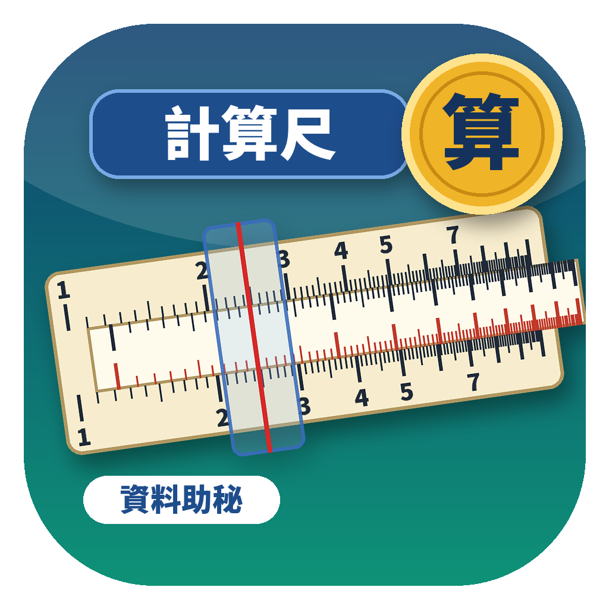

# 資料助秘計算尺




會動的虛擬計算尺：拖曳滑尺與游標、滑鼠滾輪無限放大（越放大越精確）、刻度自動環繞像圓形計算尺；
輸入算式，小柯用語音一步一步在計算尺上示範；還有讀尺練習、成績成長圖表與使用者權限。

- **計算尺**：上定尺、滑尺、下定尺＋紅色髮線游標；拖曳定尺＝整把尺移動、拖曳滑尺＝只動滑尺、
  上下空白處＝1/10 精細移動；游標讀數即時顯示每個刻度的數值。
- **25 種刻度**：C D CI DI CF DF CIF A B K R1 R2 L Ln S T T2 ST P LL1 LL2 LL3 LL01 LL02 LL03。
- **7 種尺型**：學生尺、乘除練習、三角函數、指數對數、達姆施塔特、π 摺疊、四刻度（Infinirule 風格），也可自訂並分享。
- **語音計算示範**：2×3.5、7÷2、√2、1.5³、∛27、1/8、sin 30、tan 60、log 2、ln 5、e^2、2^1.5……
- **讀尺練習**：乘法、除法、平方根號、倒數、三角、對數指數、綜合；誤差在容許範圍內算答對，記錄成績與成長。
- **計算尺知識**、**語音動態教學**（步驟聚光框＋到計算尺看示範）。
- **資料庫**：內建 MariaDB（自動啟動、關閉程式就停止），使用者與五項權限（計算尺、讀尺練習、共用尺型、成績統計、系統管理）。
- **程式內更新**、桌面捷徑、備份還原、操作紀錄。

## 下載

| 平台 | 檔案 |
|---|---|
| Windows 11 | [ZMSSlideRule-Setup-1.0.0.exe](https://github.com/achir1015/zms-sliderule/releases/latest) |
| macOS 11 以上（Intel／Apple 晶片，已公證） | [ZMSSlideRule-1.0.0-mac.dmg](https://github.com/achir1015/zms-sliderule/releases/latest) |
| 線上版（電腦、手機、平板的瀏覽器） | https://achir1015.github.io/zms-sliderule/ |
| iPhone／iPad、Android | 陸續推出 |

線上版不需要登入，也不連資料庫：計算尺、語音示範、讀尺練習、刻度一覽、計算尺知識、語音教學都能用，
自訂尺型與練習成績存在這台裝置的瀏覽器裡；要多人帳號、全班成績統計請用電腦版。

## 開發

```powershell
python -m venv .venv
.venv\Scripts\pip install flet==1.1.2 flet-desktop==1.1.2 flet-web==1.1.2 flet-audio==1.1.2 pymysql certifi edge-tts pillow qrcode pytest pyinstaller
.venv\Scripts\python main.py              # 桌面版
.venv\Scripts\python run_web.py           # 網頁預覽 http://127.0.0.1:8660（SR_DEV_LOGIN=admin:admin123）
.venv\Scripts\python tools\preview_rule.py  # 只看計算尺（不連資料庫）http://127.0.0.1:8661
.venv\Scripts\python -m pytest -q
.venv\Scripts\python tools\build_windows.py   # 建 Windows 安裝檔
```

線上版在 `docs/`（GitHub Pages：main 分支 /docs）：`docs/app/rule.js`、`demo.js` 是引擎的 JavaScript 版本（和 Python 版輸出一致），
`app.js` 是畫面；`.venv\Scripts\python tools\make_pages.py` 產生圖示、教學語音、常用算式的示範語音與 `docs/app/data.js`。

引擎在 `sr/rule.py`（刻度、刻度線、讀數，純數學）、`sr/demo.py`（算式 → 示範步驟），
畫面在 `sr/ui/ruleview.py`（計算尺元件）與 `sr/ui/rulescreen.py`。

參考：[Infinirule](https://github.com/ldo/infinirule_android)（概念：無限放大、自動環繞、以公式命名刻度；本專案程式為重新撰寫）。
計算尺知識內容整理自維基百科「計算尺」條目（CC BY-SA 4.0）。

系統開發：吳玉柱 先生 與 Claude AI Opus 5.5
